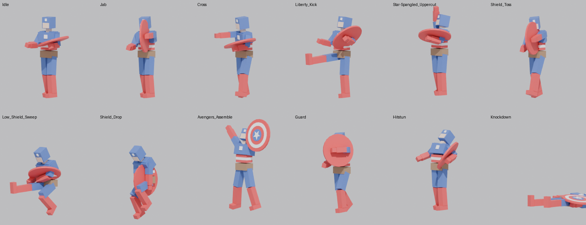

# Avengers: Assemble Re:Forged — Vertical Slice

A 2.5D, 4-player co-op beat-'em-up in Unity 6. The full design is in [`Docs/DESIGN.md`](Docs/DESIGN.md).

This repository holds the **foundation**:
- A deterministic, rollback-ready combat simulation.
- Its tests.
- The Unity layer that plays it in a graybox test room.

There is no character art yet; heroes appear as capsules colored per player.

## Quick start (Unity)

1. Open the folder with **Unity 6 LTS (6000.0.x)**. The packages in `Packages/manifest.json` resolve automatically.
2. For URP, assign a URP asset under *Project Settings → Graphics* (or create the project from the **Universal 3D** template and copy `Assets/` and `Packages/` in). Without one, the graybox renders with the built-in pipeline.
3. Run **Reforged → Build Graybox Test Room**. This generates the scene, prefabs, and materials from the simulation's own stage definition. It also exports the roster to editable HeroAssets, and picks up Captain America's Blender proxy and the pre-fractured props if they're in `Assets/_Project/Art`.
4. Press **Play**. Press any button on a gamepad (or any gameplay key) to join, then pick a hero and an Assist Callout partner on the **character select** screen:
   - ←/→ to browse
   - **A** (K) to confirm
   - **B** (L) to go back
   - The match starts when everyone is ready.

Players who join mid-match drop straight in with default picks.

### Keyboard layout

| Action | Key |
|---|---|
| Move | WASD |
| Evade flick | Arrow keys |
| Light | J |
| Heavy | I |
| Jump | K |
| Special | L |
| Grab / debris | O |
| Block / parry | U |
| Hero modifier (RT) | Left Shift |
| Assist / Relay (LT) | Q |
| Ultimate I | R |
| Ultimate II | Shift + R |
| Super | Shift + Q |
| Tools (D-pad) | 1 / 2 / 3 / 4 |
| Ping | Tab |

Gamepad bindings follow the control table in the design doc.

### Things to try in the test room

- **X X X X**: Cap's four-hit string. **↑+Y** launcher, then **A** to jump-cancel, then air **X X X**.
- **B**: the shield ricochets between the troopers and comes back. Catching it refunds gauge.
- **LT**: Iron Man swoops in. **LT+→** and **LT+↓** call his other two assist moves.
- **LT while your launched enemy is near Player 2**: Combo Relay.
- **Jump onto the orange Weak Floor**, then air **↓+Y** (Shield Drop): the floor collapses and everyone on it falls.
- **↑+B** under the grey Upper Floor: Rising Shield Slash sends the dummy up through the ceiling.
- **→+Y** into the beige Drywall: wall break, and the combo continues in the next room.
- **Y** on the crate, then **RB** to pick up the debris and **X** to throw it.
- With full gauge (3 bars), **L3+R3** for Ultimate I and **RT+L3+R3** for Ultimate II.

The Scene view draws live hurtboxes (blue), hitboxes (red), debris, and destructible health (`SimDebugDraw`).

## Art pipeline (Blender)

Art flows from Blender through validated FBX files, with no manual import settings. Scripts live in `Tools/Blender` and run in Blender 4.2+ (`blender -b -P script.py -- args`) or with the `bpy` Python module.

| Step | Command | Output |
|---|---|---|
| 1. Export frame data from the sim | `dotnet run --project Tools/FrameData` | `Docs/FrameData/*.json`, `Docs/MoveList.md` |
| 2. Build a hero proxy (rig, mesh, every animation) | `python Tools/Blender/build_proxy_hero.py captain_america` | `Art/Characters/captain_america/captain_america.fbx`, `ArtSource/Characters/captain_america_proxy.blend` |
| 3. Build pre-fractured props | `python Tools/Blender/build_fractured_props.py` | `Art/Props/<prop>_intact.fbx`, `<prop>_fractured.fbx` |
| Artists: validate and export a real model | `blender -b hero.blend -P Tools/Blender/export_hero.py -- captain_america` | Fails with a list of problems, or writes the FBX |

**The contract** (`reforged_pipeline.py`, enforced on every export):
- **Rig:** standard bone names, with extra bones prefixed `Prop_`. Every vertex is weighted.
- **Budget:** at most 60k triangles per hero.
- **Animations:** one action per move, named exactly like the move and exactly as many frames long as the move's gameplay total. There are also 12 mode clips (Idle, Walk, Hitstun, Knockdown…).
- **Style:** animations are keyed on 2s with constant interpolation (on 1s for Supers and Ultimates). The first active frame always lands on the impact pose.

The validator was checked against a deliberately broken file: it reports a renamed bone, a clip that's 2 frames short, and a missing clip.

**In Unity:**
- `ReforgedModelPostprocessor` imports characters with a generic rig and **no animation compression**, so the 2s holds stay crisp. It strips the `Rig|` prefix from clip names and loops locomotion clips.
- Fractured `*_cell_*` chunks get convex colliders and rigidbodies.
- Art materials switch to the toon shader.
- `SimAnimationDriver` plays clips as a function of sim state: the clip is the current move, and the time is the sim's `MoveFrame`. Animation can't drift from hitboxes, hitstop freezes it, and rollback re-renders it correctly.
- The `HeroAsset` inspector warns about any move without a clip, or whose clip length doesn't match its frame data.



## Toon shader

`Assets/_Project/Shaders/ReforgedToon.shader` (URP) gives:
- Stepped cel lighting with a tinted shade color.
- **Screen-space halftone dots** that grow in shadow.
- Rim light.
- An inverted-hull **ink outline**.

Two things drive the outline:
- **Impact:** `FeedbackDirector` pulses the global `_ReforgedImpact` on heavy hits, so every outline thickens for a beat.
- **Player color:** each player's hero gets an outline in their player color.

The shader needs URP to be active; without it, the builder and importer fall back to Lit or Standard.

## Running the tests without Unity

The simulation is plain C# (`Reforged.Sim.asmdef` sets `noEngineReferences`), so it builds and tests anywhere:

```bash
dotnet test Tools/SimTests
```

There are 29 NUnit tests. Unity's Test Runner runs the same files.

| Area | What the tests cover |
|---|---|
| Determinism & netcode | Identical state from identical inputs; snapshot restore; rollback with 4-frame-late remote input matching perfect information |
| Combat | 4-hit chain; cancel hierarchy only goes up; launcher and juggle decay; juggle exhaustion; parry vs. block; armor needs heavies |
| Ultimates | Two Ultimates per hero with separate inputs and costs; Team Ultimate needs every player |
| Assists | Assist callout spawn, three directional variants and cooldown; Combo Relay |
| Destruction | Floor collapse to the level below; wall break; ceiling breakthrough; debris pickup, throw and environmental hit; shield ricochet and catch |
| Content | Every playable hero uses every command; values survive the Inspector float round-trip exactly |
| Character select | Full roster shown, only built heroes pickable; assist must be someone nobody is playing; locking in a hero bumps anyone using them as assist; duplicates toggle; cameo assists (Nick Fury, War Machine) work in the sim |

## Layout

```
Assets/_Project/
  Scripts/Sim/        Deterministic simulation (no UnityEngine): fixed-point math, SimWorld, rollback, content, roster/lobby
  Scripts/Game/       Unity runtime: GameSession (lobby + 60 Hz tick), input bridge, views, sim-driven animation, authoring, presentation
  Scripts/Editor/     Scene builder, roster exporter, HeroAsset inspector, model import rules
  Shaders/            Reforged/Toon (URP): cel steps, halftone, rim, impact-reactive ink outline
  Art/Characters/     Hero FBX from the Blender pipeline (Captain America proxy)
  Art/Props/          Intact + pre-fractured prop FBX (crate, car, drywall, weak floor)
  Tests/EditMode/     NUnit tests (Unity Test Runner + dotnet)
  Input/              ReforgedControls.inputactions (gamepad + keyboard)
ArtSource/            Source .blend files (outside Assets so Unity doesn't import them)
Tools/Blender/        Blender pipeline: contract + validator, proxy hero builder, prop fracturer, artist export
Tools/FrameData/      Exports frame data JSON (for animation timing) and Docs/MoveList.md
Tools/SimTests/       dotnet test harness compiling the sim and tests outside Unity
Docs/DESIGN.md        Game design document
```

## Rules for the simulation code

- No `float`, `UnityEngine`, wall-clock time, or `Dictionary` iteration inside `Scripts/Sim`. Use `Fix` and `FixVec3`.
- Every new mutable field must be written in `Write`/`Read` (or `SaveState`). The rollback test will catch an omission.
- Presentation reads sim state and `SimEvent`s. It never writes back.
- Authoring floats become fixed-point only through `SimConvert.ToFix`, which rounds to millimetres.

## Status and next steps

**Done:**
- Combat core, rollback session
- Destruction and debris, multi-level floors
- Assist callouts and relay, two Ultimates plus the Team Ultimate
- **Character select with assist-partner picking**, and two assist-only cameos
- **Blender pipeline:** validated rig and animation contract, Cap proxy with 40 clips, pre-fractured props
- **Sim-driven animation playback**
- **Toon/halftone/ink shader**
- Graybox scene generator, debug HUD, hitbox overlay, onomatopoeia feedback

**Next:**
- Online transport (Steam or EOS) feeding `RollbackSession`
- Iron Man proxy and hero mechanics (heat, rage, density, size)
- Thor, Hulk, and the remaining kits
- VFX Graph library, and a real sculpted Cap through `export_hero.py`
- The camera Rally prompt

**Caveat:** the scripts under `Scripts/Game` and `Scripts/Editor`, and the toon shader, were written against the Unity 6, URP 17, Input System 1.11, and Cinemachine 3.1 APIs. They have not yet been compiled inside the Unity editor, so expect possible small API fixes on first import.

What has been verified:
- The simulation and tests, with `dotnet test`.
- The Blender pipeline, by running it headless: the FBX re-imports with 21 bones, 40 clips at the exact gameplay lengths, and all materials.
